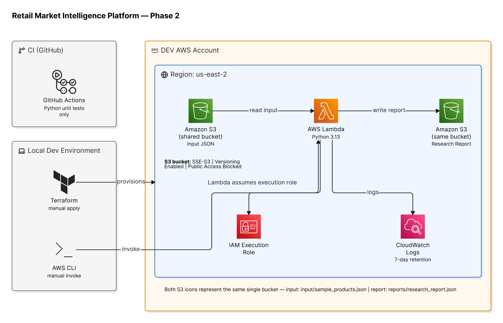

# Retail Market Intelligence Platform

**Python | AWS Lambda | Amazon S3 | Terraform | IAM | CloudWatch | GitHub Actions**

**Project Status:** Phase 1 and Phase 2 completed and verified. Phase 3 planned.

A cloud-native retail product research and analytics platform that processes product data, calculates estimated contribution profitability, ranks product opportunities, and generates research reports using Python and AWS serverless infrastructure.

The platform is being developed as a practical cloud-engineering project, with an emphasis on infrastructure as code, security, automated testing, observability, and reproducible deployment.

> **Development note:** The platform currently operates on synthetic product data. Financial estimates are illustrative and are not validated marketplace sales forecasts.

---

## 1. Project Overview

The Retail Market Intelligence Platform is designed to support systematic product research for e-commerce businesses.

Rather than relying entirely on manual analysis, the long-term goal is to build an automated research pipeline capable of collecting authorized marketplace data, analyzing product economics, identifying opportunities, and producing actionable research reports.

The project is implemented incrementally, starting with a local Python application and progressively adding AWS infrastructure and automation.

### Core objectives

- Develop a reusable Python research engine.
- Validate and transform structured product data.
- Calculate estimated product contribution margins.
- Rank products using consistent financial metrics.
- Deploy a working AWS serverless pipeline.
- Manage cloud resources using Terraform.
- Apply least-privilege IAM permissions.
- Introduce automated testing and operational monitoring.
- Extend the platform toward scheduled and AI-assisted research.

## 2. AWS Architecture — Phase 2



The deployed Phase 2 architecture operates in an AWS development account in the `us-east-2` region.

### Processing workflow

1. Synthetic product records are uploaded to an Amazon S3 bucket under `input/sample_products.json`.
2. An AWS Lambda function is invoked manually using the AWS CLI.
3. Lambda reads the source JSON from S3.
4. The Python scoring engine validates the data and calculates product profitability metrics.
5. Products are ranked by estimated monthly contribution.
6. Lambda writes a JSON research report to `reports/research_report.json` in the same S3 bucket.
7. Amazon CloudWatch records Lambda execution logs and operational metrics.

Terraform provisions the AWS infrastructure. GitHub Actions independently runs Python unit tests when changes are pushed to `main` or submitted through pull requests.

**Important:** GitHub Actions does not currently deploy infrastructure, and the Lambda function is not yet scheduled.

## 3. Technology Stack

| Technology | Purpose | Status |
|---|---|---|
| Python | Business logic and data processing | Implemented |
| JSON | Synthetic input and report format | Implemented |
| Git / GitHub | Source control | Implemented |
| unittest | Automated unit testing | Implemented |
| GitHub Actions | Continuous integration | Implemented |
| Terraform | AWS infrastructure provisioning | Implemented |
| Amazon S3 | Input and report storage | Implemented |
| AWS Lambda | Serverless Python execution | Implemented |
| AWS IAM | Execution role and S3 permissions | Implemented |
| Amazon CloudWatch | Lambda logging and monitoring | Implemented |
| Amazon EventBridge | Scheduled execution | Planned |
| Amazon DynamoDB | Persistent research data storage | Planned |
| Amazon Bedrock | AI-assisted analysis | Planned |
| External API / MCP integrations | Authorized product research data | Planned |

## 4. Phase 1 — Python Research Engine and CI

**Status: Completed**

Phase 1 established the software engineering foundation.

### Python research engine

The application reads a synthetic product dataset and computes three core metrics:

**Estimated contribution per unit**

```text
Contribution per Unit =
Selling Price - Manufacturing Cost - Shipping Cost - Amazon Fees
```

**Estimated contribution margin**

```text
Contribution Margin (%) =
(Contribution per Unit / Selling Price) × 100
```

**Estimated monthly contribution**

```text
Estimated Monthly Contribution =
Contribution per Unit × Estimated Monthly Sales
```

These calculations exclude additional expenses such as advertising, returns, storage, overhead, and taxes. They should not be interpreted as final net profit.

### Input validation

The scoring engine validates required product fields and checks for invalid financial inputs, including:

- Missing required fields.
- Zero or negative selling prices.
- Negative cost or sales values.
- Invalid numeric data types.

Invalid records raise descriptive `ValueError` exceptions.

### Automated testing

Python's `unittest` framework verifies core functionality, including successful calculation and rejection of invalid prices.

**Verified result:** 2 unit tests passed.

### Continuous integration

The GitHub Actions workflow:

- Runs on pushes to `main`.
- Runs for pull requests targeting `main`.
- Uses an Ubuntu runner with Python 3.13.
- Executes automated unit tests.

The initial GitHub Actions workflow completed successfully.

## 5. Phase 2 — AWS Serverless Deployment

**Status: Completed and verified**

Phase 2 migrated the research engine into an AWS serverless environment using Terraform.

### Amazon S3

A development S3 bucket stores both input datasets and generated research reports.

```text
s3://<research-bucket>/
├── input/
│   └── sample_products.json
└── reports/
    └── research_report.json
```

Configured storage protections include:

- Block Public Access.
- SSE-S3 encryption using AES-256.
- Bucket versioning.

Both prefixes are located within the same bucket.

### AWS Lambda

The deployed Lambda function is named:

`retail-intelligence-dev`

Configuration:

| Setting | Value |
|---|---|
| Runtime | Python 3.13 |
| Memory | 128 MB |
| Timeout | 30 seconds |
| Handler | `pipeline.lambda_handler` |
| Invocation | Manual AWS CLI |

Lambda uses the shared scoring logic in `src/scoring.py` and reads its S3 bucket name from the `RESEARCH_BUCKET` environment variable.

### AWS IAM

A dedicated Lambda execution role grants access to the required services.

The application-specific S3 policy permits:

- `s3:GetObject` for the designated input JSON object.
- `s3:PutObject` within the reports prefix.

The execution role also uses the AWS-managed basic Lambda logging policy.

### Amazon CloudWatch

CloudWatch captures invocation events, runtime performance, and execution logs.

The Lambda log group uses a **7-day retention policy**.

### Terraform

Infrastructure is managed declaratively using Terraform, including:

- S3 bucket configuration.
- Public access restrictions.
- Encryption and versioning.
- Lambda function deployment.
- IAM execution role and policies.
- CloudWatch log group.
- Infrastructure outputs.

Deployment is currently initiated manually from the local development environment.

## 6. Verified AWS Execution Results

Phase 2 was validated by invoking the deployed Lambda function, inspecting CloudWatch logs, and confirming that the output report had been created in S3.

| Metric | Verified result |
|---|---|
| Environment | AWS DEV |
| Region | us-east-2 |
| Products processed | 5 |
| Lambda execution duration | 3,283.38 ms |
| Billed duration | 3,614 ms |
| Maximum memory used | 93 MB |
| Allocated memory | 128 MB |
| Report generated | Yes |
| Output location | `reports/research_report.json` |
| Execution errors | None observed in verified run |

The cloud-generated rankings matched the results from the local Python research engine.

These values describe a verified development invocation, not benchmarked production performance.

## 7. Repository Structure

```text
retail-market-intelligence-platform/
├── .github/
│   └── workflows/
│       └── python-tests.yml
├── data/
│   └── sample_products.json
├── docs/
│   └── images/
│       └── phase2-aws-architecture.png
├── infrastructure/
│   └── terraform/
│       ├── main.tf
│       ├── lambda.tf
│       └── outputs.tf
├── src/
│   ├── scoring.py
│   ├── research.py
│   └── pipeline.py
├── tests/
│   └── test_scoring.py
├── .gitignore
└── README.md
```

## 8. Running the Application Locally

### Prerequisites

- Python 3.13 or a compatible version.
- Git.
- A terminal, such as Git Bash.

### Clone the repository

```bash
git clone https://github.com/JoshuaKabalo/retail-market-intellifence-platform.git
cd retail-market-intellifence-platform
```

### Create a virtual environment

```bash
python -m venv .venv
```

### Activate on Windows using Git Bash

```bash
source .venv/Scripts/activate
```

### Execute the research engine

```bash
python src/research.py
```

### Run unit tests

```bash
python -m unittest discover -s tests -v
```

These commands execute the local research engine without requiring AWS credentials.

## 9. AWS Deployment

**Prerequisites**

- An AWS account with appropriate permissions.
- Configured AWS CLI credentials.
- Terraform installed.
- Permission to create the relevant AWS resources.

The development deployment uses the AWS CLI profile `dev` and region `us-east-2`.

Navigate to the Terraform configuration directory:

```bash
cd infrastructure/terraform
```

Initialize Terraform:

```bash
terraform init
```

Validate the configuration:

```bash
terraform validate
```

Review the infrastructure changes:

```bash
terraform plan
```

Deploy the infrastructure:

```bash
terraform apply
```

Upload synthetic input data to the bucket indicated by Terraform outputs:

```bash
aws s3 cp ../../data/sample_products.json \
  s3://<research-bucket>/input/sample_products.json \
  --profile dev \
  --region us-east-2
```

Replace `<research-bucket>` with the actual provisioned bucket name.

Return to the repository root and invoke the Lambda function:

```bash
aws lambda invoke \
  --function-name retail-intelligence-dev \
  --payload '{}' \
  --cli-binary-format raw-in-base64-out \
  --profile dev \
  --region us-east-2 \
  response.json
```

Verify the generated report in S3:

```bash
aws s3 ls \
  s3://<research-bucket>/reports/ \
  --profile dev \
  --region us-east-2
```

**Security note:** Do not commit credentials, private configuration files, Terraform state, or other secrets to source control.

## 10. Engineering Challenges and Troubleshooting

The deployment process involved identifying and resolving practical cloud-engineering problems.

| Challenge | Resolution |
|---|---|
| AWS authentication signature mismatch | Corrected AWS CLI credentials and profile configuration |
| Terraform initialization errors | Reinitialized required providers |
| Terraform syntax errors | Corrected resource configuration |
| IAM access denied when creating roles | Updated the development account's permitted IAM actions |
| Missing Terraform outputs | Added output definitions |
| Git Bash path conversion affecting CloudWatch CLI calls | Used `MSYS_NO_PATHCONV=1` |
| Deployment artifacts appearing in Git | Updated `.gitignore` |
| GitHub remote and repository naming issues | Corrected and verified remote configuration |

These issues provided practical experience with IAM troubleshooting, cloud authentication, infrastructure deployment, command-line environments, and version control.

## 11. Project Roadmap

### Phase 1 — Local Engineering Foundation

**Completed**

- Python research engine.
- Synthetic product dataset.
- Profitability calculations and ranking.
- Input validation.
- Automated unit testing.
- GitHub Actions CI.

### Phase 2 — AWS Serverless Infrastructure

**Completed**

- Terraform infrastructure.
- Amazon S3 storage.
- AWS Lambda processing.
- IAM execution permissions.
- CloudWatch logging.
- Verified end-to-end data processing.
- Architecture diagram and documentation.

### Phase 3 — Scheduled Research Automation

**Planned**

- Introduce Amazon EventBridge scheduling.
- Run the research pipeline without manual invocation.
- Add operational failure detection.
- Improve report traceability and reliability.
- Expand automated testing.

### Phase 4 — Intelligence and Data Integration

**Exploratory / Planned**

- Integrate authorized product research data sources.
- Evaluate MCP integrations and external APIs.
- Add persistent historical research storage.
- Introduce AI-assisted review and competitor analysis.
- Improve product opportunity scoring.
- Build reporting and dashboard capabilities.

The roadmap is subject to changes as technical, security, and business requirements become clearer.

## 12. Engineering Skills Demonstrated

This project provides practical experience in:

- Python application development.
- Modular and reusable business logic.
- JSON data ingestion and transformation.
- Financial metric calculation.
- Input validation and exception handling.
- AWS serverless architecture.
- Amazon S3 object storage.
- AWS Lambda development and deployment.
- IAM permissions and execution roles.
- Terraform infrastructure as code.
- CloudWatch logging and troubleshooting.
- Git and GitHub workflows.
- Continuous integration.
- Architecture documentation.
- End-to-end infrastructure validation.

## 13. Limitations and Disclaimer

The platform is currently a development-stage engineering project.

All product data, sales volumes, and financial assumptions are synthetic. The research results are not real Amazon marketplace forecasts.

Current profitability calculations do not include all expenses required for a production e-commerce financial model.

The AWS pipeline has been verified through manual execution but does not yet support scheduled processing or production-grade operational automation.

The project is intended to evolve through incremental engineering improvements and validated integrations.